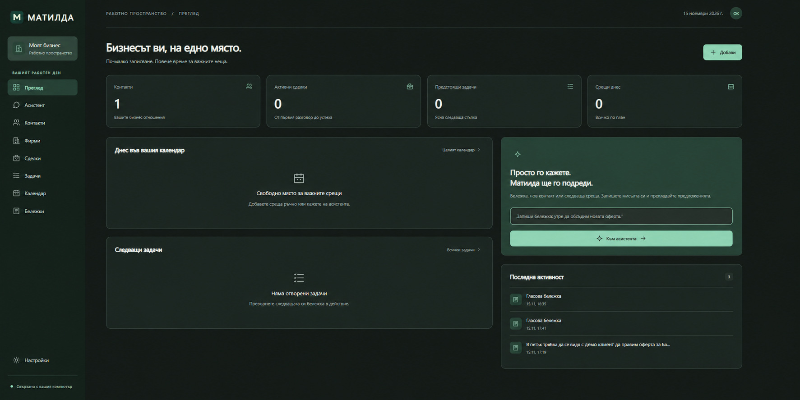
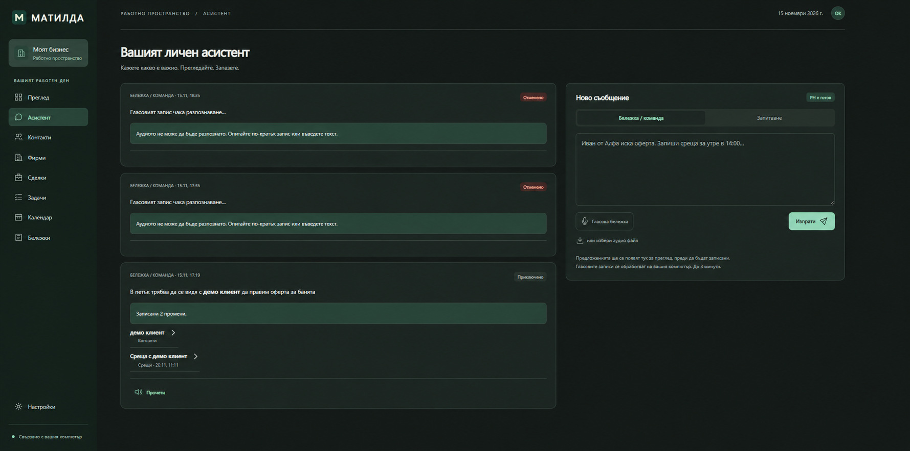
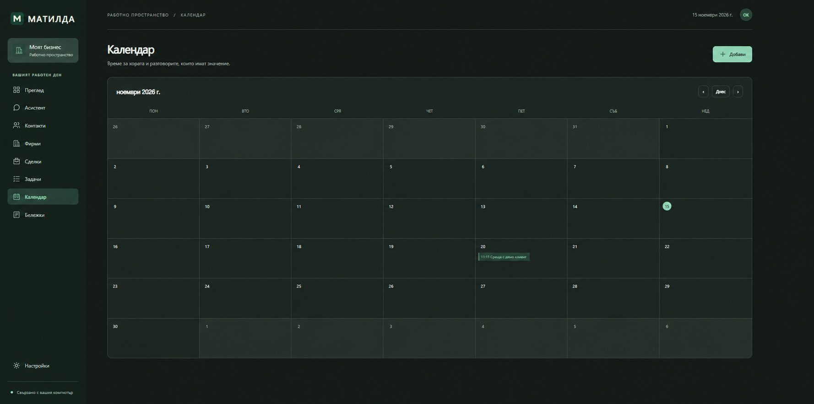
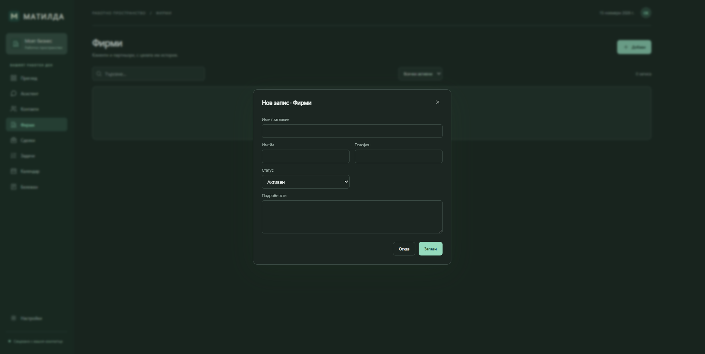
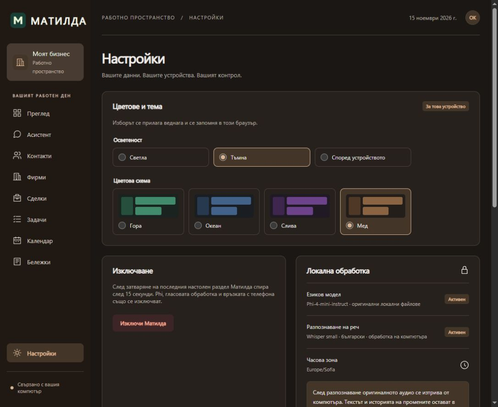

# Матилда CRM — българска CRM система

Матилда е българска CRM система с отворен код за управление на малкия бизнес: контакти, фирми, сделки, задачи, срещи, бележки и локален асистент с Phi-4-mini-instruct. Текстът и гласовите бележки се обработват на вашия компютър. Предложенията се преглеждат преди запис; липсващите данни се попълват с менюта и полета.

**Български език · Отворен код · MIT · Windows x64 · Локална обработка**

Разклонения (форкове), предложения за промени, преводи и собствени адаптации са добре дошли. За начало: [Ръководство](docs/HOW-TO.md) · [Архитектура](docs/ARCHITECTURE.md) · [Одит на сигурността](docs/AUDIT.md) · [Как да допринесете](CONTRIBUTING.md).

## Галерия

Изберете снимка, за да я разгледате в пълен размер. Показаните записи са демонстрационни.

| Личен AI асистент | Календар и срещи |
| --- | --- |
|  |  |
| **Добавяне на фирма** | **Настройки и цветови теми** |
|  |  |

## Инсталиране на Windows

1. Разархивирайте `Matilda-CRM-Setup.zip` в отделна папка.
2. Отворете **INSTALL.vbs**. Изберете празна папка за инсталиране.
3. Наличният Phi в стандартния Hugging Face кеш се открива автоматично. За друга папка натиснете „Избери“. Файловете на модела остават на мястото си. Само ако нямате модела, можете изрично да отметнете изтеглянето му.
4. Натиснете **„Инсталирай и отвори“**. Инсталаторът подготвя Python, зависимостите, гласовия модел и пряк път **„Матилда“** на работния плот. Не се въвеждат команди.

При първата инсталация е нужен интернет. Python и библиотеките се изтеглят от официалните им източници; инсталаторът проверява подписа на Python Software Foundation. Инсталацията може да отнеме няколко минути и няколко GB. Phi се изтегля само при избрана отметка и празно поле за наличен модел. Гласовите бележки са отделна опция.

Използва се Python 3.12 x64. При липса на подходящ Python се инсталира [официалният Windows пакет 3.12.10](https://www.python.org/downloads/release/python-31210/), последният двоичен инсталатор в тази серия. AI runtime е [PyTorch 2.5.1 CPU/CUDA 12.1](https://pytorch.org/get-started/previous-versions/) и Transformers 4.57.6. По-нов хардуер може да изисква обновяване на PyTorch. За бърза работа е препоръчителна съвместима NVIDIA карта с поне 10–12 GB VRAM и 24 GB RAM; без CUDA има по-бавен CPU режим, за който се препоръчват 32 GB RAM. Съществуващи Python среди не се променят.

Инсталаторът е за нова инсталация в празна папка. Не презаписва съществуваща CRM. При грешка показва пътя към лог; преди нов опит изберете друга празна папка. Текущият пакет е за Windows x64, не за macOS/Linux.

## Отваряне и изключване

Отваряйте **Матилда.lnk** или **START_CRM.vbs**: показва се само браузърът. Phi се зарежда във фонов режим. При повторно отваряне се използва същият сървър.

**Настройки → Цветове и тема:** Гора, Океан, Слива и Мед; светла, тъмна или според устройството. Изборът се запомня отделно във всеки браузър.

**Настройки → Изключи Матилда** спира CRM, Phi, гласовата обработка и HTTPS входа. Същото става 15 секунди след затваряне на последния свързан настолен раздел на собственика. Презареждането на страницата не прекъсва работата. Докато използвате телефона, оставете настолния раздел отворен. Спящ компютър или загубена връзка могат също да прекъснат сесията; стартирайте от прекия път при нужда. Незаписаният текст във формите не е запис в CRM.

Данните остават в `data/`, логовете — в `runtime/`. Резервно копие се изтегля от „Настройки“. В пакета няма потребителска база, пароли, сертификати или модели.

## Android и iPhone

Мобилната част е адаптивна PWA. На компютъра отворете `START_PHONE_ACCESS.cmd`. Адресите се откриват автоматично от неговите текущи мрежови интерфейси; в пакета няма фиксиран IP. HTTPS сертификатът се обновява при смяна на адресите, като локалният CA се запазва. В „Настройки → Телефон и устройства“ се показват актуалните адреси (и дали входът е включен). При няколко мрежи изберете адреса на общата мрежа с телефона. Инсталирайте **само публичния** `data/tls/phone-ca.cer` като доверен сертификат на телефона. Частните ключове остават на компютъра. На iPhone включете и пълното доверие за сертификата. Отворете `https://<IP-на-компютъра>:8443`, свържете телефона с еднократен код от настройките и добавете приложението на началния екран.

HTTPS е необходим за микрофона. Защитната стена и доверието към сертификата изискват еднократна настройка на съответното устройство; инсталаторът не изключва защити. За работа извън локалната мрежа е нужен отделно настроен частен VPN. Не публикувайте портовете директно в интернет.

## GitHub и разработка

`INSTALL.vbs` е входът за инсталиране. Не качвайте `data/`, `runtime/`, `.venv/`, `.python/`, `models/` или `config.json`. Изходният код е под [MIT лиценз](LICENSE). Моделите и зависимостите имат собствени лицензи и не са включени в хранилището.

За нов архив: `python tools/build_release.py`. Архивът се изгражда по изричен списък с разрешени файлове и съдържа SHA-256 опис. GitHub workflow изгражда архив при ръчно стартиране и при таг `v*`, без автоматично публикуване на Release.

Текущи граници: един собственик с няколко устройства; няма отделни права за служители, няма native APK/IPA. Автоматичният анализ може да греши — преглеждайте предложените данни. Базата и архивите не са криптирани от CRM; използвайте защитен диск и резервни копия. Пълната инсталация на чист Windows и физически телефони предстои да бъде проверена.
