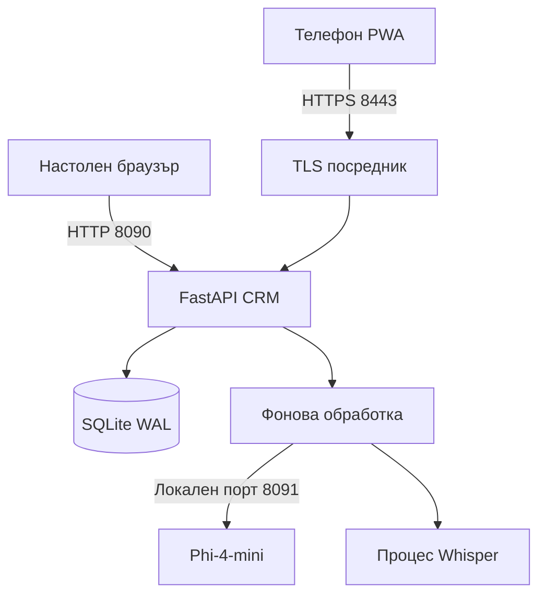

# Архитектура на Матилда CRM

Матилда е локално приложение за Windows за един собственик с няколко устройства. Интерфейсът е на български, сървърът използва SQLite, а езиковият модел работи като отделна локална услуга. При работа с CRM не е необходим облачен акаунт.

| Компонент | Предназначение |
| --- | --- |
| `launcher.py`, `crm/process_group.py` | Управление на процесите в Windows, един екземпляр и координирано спиране чрез Job Object |
| `crm/app.py`, `crm/lifecycle.py` | Програмен интерфейс, сесии, свързване на устройства, преглед и жизнен цикъл |
| `crm/store.py`, `crm/schema.py` | SQLite, валидиране, транзакции, версии на записите и история |
| `crm/ai.py`, `crm/normalize.py`, `crm/completion.py` | Структурирани предложения, проверка на източника, дати и форми за допълване |
| `crm/model_server.py` | Локален езиков модел чрез Transformers на CPU/CUDA със safetensors |
| `crm/transcribe.py` | Локално разпознаване на реч чрез Whisper в отделен процес |
| `crm/tls_proxy.py`, `crm/tls_setup.py`, `crm/network.py` | HTTPS в частната мрежа и управление на сертификатите |
| `static/` | Браузърен интерфейс, теми, PWA и криптирана офлайн опашка |
| `installer/`, `tools/` | Инсталатор за Windows и изграждане на пакет по разрешен списък |

Жизнен цикъл при запис: опашка → обработка → преглед/попълване → потвърждение от потребителя → транзакционен запис и история на промяната. Аудиото преминава през разпознаване на реч и преглед на транскрипцията. Режим „Запитване“ само чете. Грешките и отказаните съобщения остават в историята. AI не определя правата за достъп: сървърът валидира операциите, а собственикът проверява съдържанието.

Инсталационната папка съдържа `config.json`, `data/` (база, ключ на собственика, идентификатор на работното пространство, TLS и временно аудио), `runtime/` (процеси и логове), кеш на моделите и изолирана Python среда. Тези данни не се качват в Git. Само `static/` се обслужва като статично уеб съдържание.

Граници на доверието: администраторът управлява устройствата и архивите; свързаните устройства споделят едно работно пространство и могат да четат и редактират записите. Няма изолация по организации или отделни права за служители. Локалният TLS CA се инсталира ръчно на телефона. SQLite и частните TLS ключове не са криптирани от приложението на диска.
